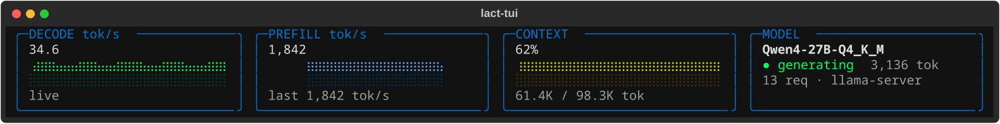
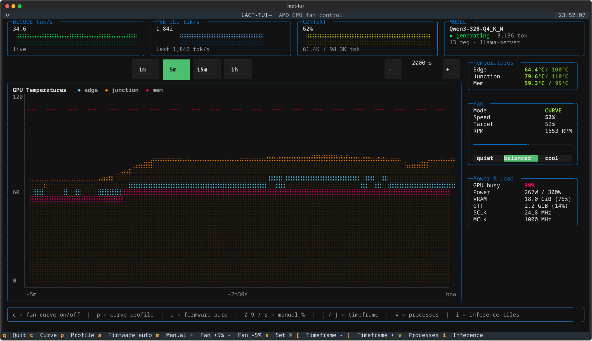
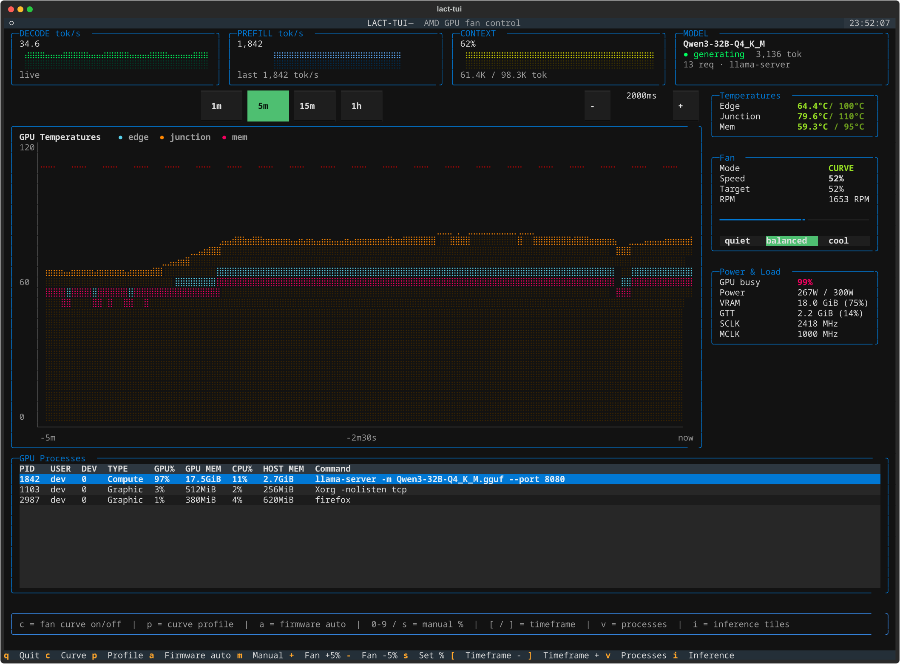

<div align="center">



# LACT-TUI

**AMD GPU fan control in the terminal, with live llama.cpp inference telemetry.**

[](LICENSE)


</div>

LACT-TUI talks to the `amdgpu` hwmon interface in `/sys/class/drm/` directly:
no `lactd`, no root daemon, no plotting library. One Textual app draws a
btop-style temperature graph, a strip of inference tiles for the llama.cpp
model currently loaded on the card, and an nvtop-style process table, and it
drives the fan itself when you want a real curve.



## What it does

- **Live temperature graph.** Edge / junction / memory as three coloured series
  with a dashed line at the junction critical temperature, a fill under each
  curve, and switchable timeframes (1m / 5m / 15m / 1h). The last timeframe is
  remembered between runs.
- **Inference tiles.** Decode and prefill tokens per second of the model on the
  card, each with a sparkline, plus context use and a model/state tile. See
  [Inference tiles](#inference-tiles).
- **Side panels.** Fan mode, RPM and duty cycle, GPU busy, power draw,
  VRAM/GTT use and clocks. Temperatures shift green -> yellow -> red as they
  approach the sensor's critical value.
- **Fan control.** Firmware auto, manual, or the app's own fan curve.
  Manual speed via `+` / `-` (5% steps), `0`-`9` (0%-90%), or `s` for an exact
  value. Any manual key stops the curve.
- **GPU processes.** `v` opens a table of the processes with a DRM fd on the
  card: user, engine type, GPU%, VRAM, CPU% and command line.

The UI never blocks on a read or a redraw: hwmon, `/slots` and the `/proc`
scan all run on worker threads, and the charts are braille glyphs rendered in
about two milliseconds.

## Screenshots

<table>
<tr>
<td width="50%"></td>
<td width="50%"></td>
</tr>
<tr>
<td><em>Live graph, inference tiles, fan and power panels.</em></td>
<td><em><code>v</code> opens the process table.</em></td>
</tr>
</table>

## Requirements

- Linux with the `amdgpu` driver and a fan exposed through `pwm1`
  (`/sys/class/drm/card*/device/hwmon/hwmon*/pwm1`). Monitoring works without
  it; fan control does not.
- Python 3.10 or newer.
- `sudo` for fan writes. Read-only monitoring needs no privileges.

## Run it

```sh
git clone https://github.com/yaminerl/gpu-control-panel
cd gpu-control-panel
./run.sh
```

`run.sh` creates `.venv/` on first run and installs `textual` into it. To do it
by hand:

```sh
python3 -m venv .venv
.venv/bin/pip install -r requirements.txt
.venv/bin/python main.py
```

Pass `--debug` to show the discovered hwmon path as a startup toast.

## Keys

| Key | Action |
|-----|--------|
| `q` / `Ctrl+C` | Quit |
| `c` | Fan curve on / off |
| `p` | Next fan curve profile |
| `r` | Reload the fan curve config |
| `a` | Fan mode: firmware auto |
| `m` | Fan mode: manual |
| `+` / `-` | Fan speed +5% / -5% |
| `0`-`9` | Jump fan speed to 0%-90% |
| `s` | Type an exact fan speed |
| `[` / `]` | Previous / next graph timeframe |
| `v` | Show / hide the GPU process list |
| `i` | Show / hide the inference tiles |

## Inference tiles

The four tiles above the graph (same idea as the Strata terminal monitor: a
label, a big value, a small live graph) report the llama.cpp model that is
loaded on the GPU:

| Tile | Shows |
|------|-------|
| `DECODE tok/s` | tokens the model is generating right now (the last finished request's rate when idle) |
| `PREFILL tok/s` | prompt-processing rate (the last finished request's rate when idle) |
| `CONTEXT` | context used / window, as a percentage with a token count |
| `MODEL` | model name, state (`idle` / `prefill` / `generating`), request count, where the data came from |

Numbers come from llama.cpp's `/slots` endpoint, polled twice a second on a
worker thread. llama.cpp updates its counters once per batch, so a rate is the
counter delta divided by the time since that counter last moved; dividing by
the poll interval would report 2,048 tok/s for a 1,024-token prefill batch that
arrived after 2.5 s.

Nothing needs configuring. The server is found in this order:

1. `LACT_TUI_LLAMA_URL` (with `LACT_TUI_LLAMA_KEY` or `LACT_TUI_LLAMA_KEY_FILE`)
2. a `llama-server` process owned by you: `--host` / `--port`,
   `--api-key-file` and `-m` are read from `/proc/<pid>/cmdline`, which also
   works when llama-swap or a script started it
3. llama-swap on `127.0.0.1:8091` (`/running` lists the child's URL and command)
4. the usual ports (8080, 8096) with the usual key-file locations

The strip stays hidden while no server answers, so a fan-only view is
unchanged; it appears by itself once one does. `i` toggles it manually and
polling continues while it is hidden.

## Fan curve

RDNA2 cards have no editable fan curve in sysfs (`gpu_od/fan_ctrl/` is RDNA3+
only), and `pwm1_enable=2` is just the SMU firmware's fixed behaviour. So `c`
runs a curve inside the app: the GPU goes to manual mode and the app writes
`pwm1` once a second from the temperature readings.

- Three profiles, switched with `p` or the buttons in the Fan panel: `quiet`
  (zero-RPM until about 55C junction, slow spin-down), `balanced`, and `cool`
  (fan always on, steep ramp, reacts early to a fast rise).
- Each profile has a curve per sensor (junction and memory by default). The fan
  follows whichever sensor asks for the most.
- Readings are smoothed, so a short spike does not make the fan jump; a rising
  temperature makes it ramp early (look-ahead, capped at 8C).
- Hysteresis plus a spin-down delay: the fan rises at once but only slows after
  the temperature has really dropped, then ramps down gently. That also stops
  zero-RPM on/off cycling.
- Fail safe: 100% at once if the junction reading is missing or any sensor
  comes within `emergency_margin_c` (default 10C) of its critical temperature.
- One root helper process does the writes (one password prompt per session, no
  PAM login per write). It accepts only numbers 0-255. When the app exits,
  crashes or is killed, the helper's pipe closes and it puts the fan back on
  firmware auto. If something else changes `pwm1_enable` while the curve runs,
  the curve stops.

## Configuration

Two small state files live next to the checkout and are gitignored:

| File | Contents |
|------|----------|
| `.lact_tui_state` | last graph timeframe, in seconds |
| `.lact_tui_probe_interval` | hwmon poll interval in ms (500-5000) |
| `.lact_tui_fancurve.json` | fan curve profiles (written with the defaults on first run) |

To start from a clean, fully commented example instead of the defaults:

```sh
cp examples/fancurve.example.json .lact_tui_fancurve.json
```

Edit it and press `r` to reload. A bad file is reported and ignored, and the
built-in defaults are used. Fields per profile:

```json
{
  "junction": [[55, 0], [60, 22], [70, 30], [80, 45], [100, 100]],
  "mem": [[75, 0], [80, 25], [94, 100]]
}
```

is a `curves` map of `sensor -> [[temp_c, pct], ...]` (ascending temperature),
next to `min_spin_pct`, `hysteresis_c`, `spin_down_delay_s`,
`ramp_down_pct_per_s`, `ramp_up_pct_per_s`, `smoothing_s` and `lookahead_s`.
The top-level keys are `active`, `autostart` and `emergency_margin_c`.

The curve starts when the app opens, so you get the password prompt at
startup. Cancel it to stay on firmware auto, or set `"autostart": false`. The
curve runs only while the app is open.

## Sysfs layout this relies on

Base: `/sys/class/drm/card*/device/hwmon/hwmon*/` where `name` is `amdgpu`.
It is discovered at runtime, not hardcoded to a card or hwmon index, because
those change across reboots and driver reloads.

- `pwm1`, `pwm1_enable` (0 = no control / full speed, 1 = manual,
  2 = firmware auto), `pwm1_min`, `pwm1_max`, `fan1_input`, `fan1_min`,
  `fan1_max`
- `temp{1,2,3}_input` / `_label` / `_crit` / `_crit_hyst` / `_emergency`
  (edge / junction / mem)
- `power1_average`, `power1_cap*` (display only, never written)

From the sibling device directory (`card*/device/`, not inside `hwmon/`):
`gpu_busy_percent`, `mem_info_vram_{used,total}`, `mem_info_gtt_{used,total}`,
`pp_dpm_sclk`, `pp_dpm_mclk`. The process table reads `fdinfo` of the
processes holding a DRM file descriptor on the card.

## Development

```sh
PYTHONPATH=. .venv/bin/python tests/test_app.py     # or: pytest tests/ -q
```

The chart, sparkline and inference-rate checks run anywhere. The app checks
need an `amdgpu` hwmon node and skip themselves without one; they restore the
state files they touch.

The README screenshots are generated from synthetic data, so they never
contain anything from the machine that renders them:

```sh
.venv/bin/python tools/render_screenshots.py        # needs rsvg-convert
```

```
main.py                 entry point
run.sh                  venv setup + launch wrapper
lact_tui/
  hwmon.py              hwmon discovery + sysfs reads (no writes)
  fancurve.py           curve profiles, config file, curve controller
  privileged.py         sudo-authenticated writes + the root fan helper
  graphs.py             braille area charts + sparklines (no plotting library)
  inference.py          the DECODE / PREFILL / CONTEXT / MODEL tiles
  llama.py              llama.cpp discovery and live token-rate polling
  widgets.py            bordered live-stat side panels
  screens.py            password modal, set-speed modal, "no GPU found" screen
  app.py                the Textual App: layout, workers, keybindings
  styles.tcss           Textual CSS
tests/test_app.py       headless smoke checks
tools/
  render_screenshots.py README image generator (fake hwmon + fake snapshots)
examples/
  fancurve.example.json fan curve config to start from
```

## Scope

Fan control and monitoring only: no overclocking, power-limit editing or
power-profile switching. The name is a nod to [LACT](https://github.com/ilya-zlobintsev/LACT);
this is an independent tool and does not use its daemon. Built and used on
RDNA2 (Navi 21), where the kernel offers no fan curve of its own.

## License

[MIT](LICENSE).
